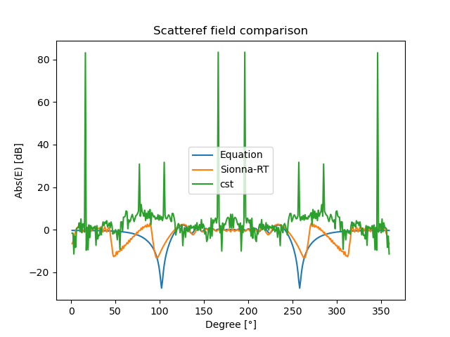

# Electromagnetic validation

The aim of this section is to validate the RX results comparing with full-wave electromagnetic comparison from CST. 

Results from CST are not good, probabily the teaching version of CST doen't allow to have enough mesh cells to run a reliable simulation.

